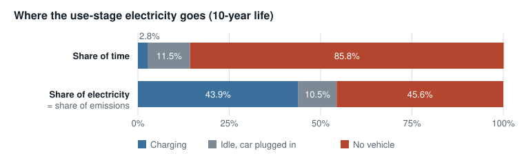

# Carbon Footprint of a Typical Level 2 AC Wallbox

A cradle-to-grave product carbon footprint (PCF) of a typical U.S. Level 2 AC EV charger (wallbox), built entirely from public data. It is the first half of a study that will size a carbon dioxide removal (CDR) plan for the charger's residual emissions.

**🌐 Website version:** https://loying1005.github.io/ev-charger-pcf-cdr/

> **Disclaimer**
> Independent learning project that uses public data only.
> It does not represent any company's products or confidential data.
> Screening-level study: secondary data, no third-party critical review, and no comparative assertions.

## Purpose

| | |
|---|---|
| **Reduce** | Find the hotspots that product design and energy choices can cut. |
| **Neutralize** | Quantify the residual emissions a CDR portfolio must remove. |
| **Check** | Test the result for plausibility against published PEPs. |

## Research questions

| | Question |
|---|---|
| RQ1 | What is the cradle-to-grave carbon footprint of a typical Level 2 AC wallbox? |
| RQ2 | Which life cycle stages and materials are the emission hotspots? |
| RQ3 | How much does the installation location change the result, California vs. Texas? |
| RQ4 | Is the result consistent with published PEPs for similar wallboxes? |
| RQ5 | Which CDR portfolio could credibly neutralize the residual emissions? |

## Results

The table shows the total carbon footprint of the same wallbox over its 10-year life, from raw materials to disposal. The only difference is where it is installed: California or Texas. The location changes the electricity the charger itself uses while it works and waits. The first row is the total for one wallbox. The second row spreads that total over every kWh the charger supplies to cars.

| | Installed in California | Installed in Texas |
|---|---:|---:|
| **Per wallbox** | **162.8 kg CO₂e** | **266.4 kg CO₂e** |
| Per kWh supplied to the vehicle | 5.76 g CO₂e | 9.43 g CO₂e |

Declared unit: one wallbox over a 10-year service life. Functional unit: 1 kWh supplied to one vehicle under the PSR-0018 reference scenario (28,251 kWh over the life).

**Key findings**

1. **The hotspot is the charger's own electricity, not the factory:** the use stage is 67% of the total in California and 80% in Texas. 46% of that electricity is drawn while no vehicle is plugged in. Under the PSR reference scenario, that standby alone emits about as much in California (49.4 kg CO₂e) as manufacturing the whole charger (49.5 kg). See [where the use-stage electricity goes](#where-the-use-stage-electricity-goes).
2. **The grid decides the result:** the same charger has a 64% higher footprint in Texas than in California, because the Texas grid emits about twice as much per kWh.
3. **Manufacturing is led by electronics:** the printed circuit board weighs 0.56 kg but causes 36% of material emissions. Manufacturing (49.5 kg CO₂e) falls within the range of published PEPs (41–126 kg).

## Hotspots by life cycle stage

| Life cycle stage (module code) | California | Texas | Main driver |
|---|---:|---:|---|
| Manufacturing (A1–A3) | 49.5 | 49.5 | PCB, PC housing, copper, PSR default manufacturing waste |
| Distribution (A4) | 3.8 | 3.8 | 19,000 km by ship + 1,000 km by lorry |
| Installation (A5) | 0.3 | 0.3 | Packaging waste and its transport |
| Use (B1–B7) | 108.4 | 212.1 | 580.8 kWh of the charger's own consumption × state grid factor |
| End of life (C1–C4) | 0.8 | 0.8 | 1,000 km by lorry + landfill |
| **Total** | **162.8** | **266.4** | kg CO₂e per wallbox |

Module codes are the standard stage labels used in PEP declarations (EN 15804 / EN 50693): A1–A3 raw materials to factory gate, A4 transport to site, A5 installation, B1–B7 use, C1–C4 end of life. Module D (recycling benefits) is reported separately and not added to the total.

## Where the use-stage electricity goes

Over its 10-year life the charger is always in one of three modes. Under the PSR-0018 scenario it charges a car 1,040 times. Each time the car stays plugged in for 12 hours, but charging takes only 2.4 hours at 11.52 kW. For the rest of the life no car is connected, and the charger still draws a few watts to stay ready.



| Mode | What happens | Hours in 10 years | Power | Electricity | California (kg CO₂e) | Texas (kg CO₂e) |
|---|---|---:|---:|---:|---:|---:|
| Charging | Power flows to the car; the charger loses some as heat | 2,446 (2.8%) | 104.4 W loss | 255.2 kWh (43.9%) | 47.7 | 93.2 |
| Idle, car plugged in | Car is connected but full, waiting | 10,034 (11.5%) | 6.1 W | 60.8 kWh (10.5%) | 11.3 | 22.2 |
| No vehicle | Nothing connected; charger on standby | 75,120 (85.8%) | 3.5 W | 264.8 kWh (45.6%) | 49.4 | 96.7 |
| **Total** | | **87,600** | | **580.8 kWh** | **108.4** | **212.1** |

> **Note:** The no-vehicle standby draws only 3.5 W (median), but under the PSR scenario it lasts 86% of the life. Over 10 years it emits 49.4 kg CO₂e in California, about the same as manufacturing the whole charger (49.5 kg). Across the middle half of ENERGY STAR chargers (2.7–5.2 W) the range is 39–73 kg, so standby and manufacturing are the same order of magnitude; in Texas, standby is about twice manufacturing. Cutting standby power is the cheapest reduction lever before any carbon removal is needed.

Power = median of 386 ENERGY STAR-certified Level 2 chargers (S21); hours follow the PSR-0018 scenario (S01): 1,040 charges × 27.09 kWh, 12 hours plugged in per charge. Emissions = electricity × state grid factor (0.1867 kg CO₂e/kWh California, 0.3651 Texas; eGRID2023 with grid losses, S20). Each mode's share of emissions equals its share of electricity, because all three use the same grid. The 86% comes from the PSR reference scenario (a European survey), not U.S. measurements; a U.S. charging pattern and the full standby range will be tested in notebook 03. The 39–73 kg range uses the 25th–75th percentile of S21 no-vehicle power.

## What drives manufacturing

Manufacturing totals 49.5 kg CO₂e: materials 38.4 kg (including packaging) plus 11.1 kg for the PSR default manufacturing waste. Four materials cover 80% of the material emissions; these are the datasets that PCR ed4 requires to be quality-scored.

| Material | kg CO₂e per wallbox | DQR |
|---|---:|---:|
| PCB | 13.9 | 3.0 |
| PC housing | 6.7 | 3.0 |
| Copper (cable, body) | 5.9 | 2.67 |
| PVC cable jacket | 4.4 | 2.33 |
| Connector (as copper) | 2.0 | 3.0 |
| Cardboard | 1.9 | 2.33 |
| PA | 1.2 | 2.33 |
| Steel | 1.0 | 3.0 |
| Seven other materials | 1.5 | — |
| **Total materials** | **38.4** | |

Material emissions = mass × emission factor. DQR is the PCR data quality rating (1 best, 5 worst); 2–3 is "good".

## Benchmark against published PEPs

Five attached-cable wallboxes were selected from the 40 EV charging PEPs in the PEP ecopassport registry. The comparison is a plausibility check of the order of magnitude, not a comparative claim: the PEPs use European grids, other databases, and three-phase designs.

| Product | Manufacturing per wallbox (kg CO₂e) | Life cycle per kWh (g CO₂e) |
|---|---:|---:|
| **This study** | **49.5** | **5.76 (CA grid) / 9.43 (TX grid)** |
| Legrand 1-ph (S10) | 41.2 | 6.99 (EU) |
| Legrand 3-ph (S11) | 48.6 | 6.28 (EU) |
| Ensto (S12) | 53.0 | 11.3 (EU) |
| Hager witty One (S13) | 126.3 | 8.59 (Europe) |

Qovoltis (S14) is excluded from the emission benchmark: its manufacturing result (220 kg) appears to use a different database, and its use stage assumes a 2 Ω contact resistance (28% of delivered energy lost as heat), which is not physically plausible. Only its material composition is used.

> **Note:** The first materials-only result (38.4 kg) was below every PEP. Tracing that gap led to the PSR rule for manufacturing waste that had not yet been modeled. After adding it, the result moved into the PEP range.

## Method at a glance

| | |
|---|---|
| **Framework** | ISO 14067 / ISO 14040–44, applied through PEP ecopassport PCR ed4 (2021) and PSR-0018 ed1.3 for EV charging infrastructure (2025). The ISO standards themselves were not directly consulted. |
| **Product** | Typical U.S. Level 2 AC wallbox with an attached 24 ft cable: 7.13 kg product + 2.05 kg packaging. |
| **Functional unit** | Supply 1 kWh to one vehicle through a Level 2 AC wallbox for private or semi-public use, per the PSR-0018 reference scenario. |
| **Boundary** | Cradle to grave. Electricity delivered to the vehicle is excluded (assigned to the vehicle under PSR-0018). |
| **Indicator** | Climate change (kg CO₂e), IPCC AR5 GWP100 across all datasets. |
| **Data** | Public only: PSR/PCR defaults, five PEPs, ICA copper LCA, PlasticsEurope PA6, UK DESNZ 2026 factors, EPA eGRID2023, ENERGY STAR measured data for 386 chargers. |

## Notebook 01 · Scope and boundary

Six decisions made before any number was calculated. Each one constrains everything after it. Click a step to expand it.

<details>
<summary><b>§1 Goal</b> — Why the footprint is calculated and for whom.</summary>

- **Problem:** Define intended application, audience, and whether public comparisons are made.
- **Solution:** Two uses (hotspots; residual emissions for CDR) plus a benchmark against PEPs; no third-party review, so no comparative claims.
- **Result:** Framed as a screening-level study following the ISO 14067 framework through PCR ed4 and PSR-0018.
- **Note:** Goal statement that sets how rigorous every later choice must be.
</details>

<details>
<summary><b>§2 Functional unit and reference flow</b> — What one unit of the product's function is.</summary>

- **Problem:** Per wallbox or per kWh? The PSR also gives a 10-year lifetime and 28,251 kWh, derived from a French driving survey.
- **Solution:** Adopted the PSR-0018 functional unit (1 kWh supplied to one vehicle) for comparability, and kept the declared unit (one wallbox, 10 years) for CDR sizing.
- **Result:** Reference flow: 1/28,251 of one single-point wallbox per kWh, including the attached cable, packaging, and supplied accessories.
- **Note:** Cable presence and length were verified from four U.S. datasheets instead of assumed: 23–25 ft, base 24 ft (A02).
</details>

<details>
<summary><b>§3 System boundary</b> — Which life cycle stages and processes are counted.</summary>

- **Problem:** Which processes inside each stage are excluded?
- **Solution:** Cradle to grave, as the PEPs use; exclusions listed per stage from PSR-0018 §3.2.
- **Result:** Grid connection, monitoring networks, hand tools, building works, and electricity delivered to the vehicle are excluded.
- **Note:** All eight stages included with a written justification.
</details>

<details>
<summary><b>§4 Cut-off rules</b> — What may be left out.</summary>

- **Problem:** Small items can be excluded, but low-mass, high-impact parts must not be.
- **Solution:** PCR ed4 §2.3: excluded flows ≤ 5% of mass, energy, and impact in aggregate; Table 2 materials (copper, gold, silver, microprocessors) always included.
- **Result:** Compliance demonstrated in notebook 02 with an exclusion summary table.
- **Note:** Quantified, testable rule.
</details>

<details>
<summary><b>§5 Data quality requirements</b> — The bar data must meet before it is used.</summary>

- **Problem:** Public data only, unknown production location.
- **Solution:** PCR ed4 §2.9: data within 10 years, global or regional averages (A03), U.S. grid data for use, PCR source priority, DQR = (TeR + GR + TiR) / 3.
- **Result:** The same scores are reused in notebook 03 to derive pedigree uncertainty ranges.
- **Note:** One scoring basis for both the quality report and the Monte Carlo analysis.
</details>

<details>
<summary><b>§6 Consistency review</b> — An assurance-style check before calculating.</summary>

- **Problem:** Wording drifted from later decisions; the research question was empty.
- **Solution:** Aligned the goal, README, and sources; recorded that ISO texts were applied through the PCR and PSR.
- **Result:** All checks passed.
- **Note:** Every decision traceable to a source or an assumption.
</details>

## Notebook 02 · Inventory and calculation

Eleven steps from parameters to a cut-off check. Each step shows what it does, what problem came up, how it was solved, and the result.

<details>
<summary><b>§0 Parameters</b> — Carry the notebook 01 decisions into the calculation.</summary>

- **Solution:** Fixed parameters with source IDs.
- **Result:** 28,251 kWh, 10 years, 24 ft cable, 5% cut-off, DQR settings.
</details>

<details>
<summary><b>§1 Data sources</b> — Choose where emission factors come from.</summary>

- **Problem:** No paid databases; the PlasticsEurope PC eco-profile could not be downloaded.
- **Solution:** Industry LCIs where available (ICA copper, PlasticsEurope PA6), UK DESNZ 2026 for the rest, EPA eGRID2023 for the grid; each with its PCR priority level.
- **Result:** Four sources cover every material; PC and PCB rely on category proxies.
</details>

<details>
<summary><b>§2 Proxy BOM</b> — Build the bill of materials without manufacturer data.</summary>

- **Problem:** Only one public PEP is a single-phase wallbox with a cable; datasheets do not say whether weights include the cable.
- **Solution:** Screened the PEP registry (40 → 5 attached-cable wallboxes); triangulated body mass from sources that state it without cable; estimated cable copper from conductor sizes; split materials with the mean of five PEPs.
- **Result:** 7.13 kg product (body 3.6, cable 3.0, connector 0.54) + 2.05 kg packaging; mass balance closes; ENERGY STAR later confirmed 25 ft / 8 AWG as the market median.
</details>

<details>
<summary><b>§3 Emission factors and DQR</b> — Assign a factor and a quality score to every material.</summary>

- **Problem:** Which materials matter enough to score strictly?
- **Solution:** PCR Annex E scoring; datasets covering 80% of impact flagged.
- **Result:** PCB 36%, PC 17%, copper 15%, PVC 11% of material emissions; DQR 2.3–3.0 (good).
</details>

<details>
<summary><b>§4 Manufacturing</b> — Materials plus processing.</summary>

- **Problem:** The materials-only result (38.4 kg) was below every PEP.
- **Solution:** Confirmed DESNZ factors include forming; added the PSR default manufacturing waste (30%, conservative reading).
- **Result:** 49.5 kg CO₂e, within the PEP range.
</details>

<details>
<summary><b>§5 Distribution and installation</b> — Transport to site and packaging waste.</summary>

- **Problem:** Factory location unknown.
- **Solution:** PCR international default (19,000 km ship + 1,000 km lorry); PSR packaging end-of-life rates.
- **Result:** Distribution 3.76 kg; installation 0.26 kg.
</details>

<details>
<summary><b>§6 Use stage</b> — The charger's own electricity, California vs. Texas.</summary>

- **Problem:** PSR formula needs contact resistance and standby data; eGRID rates are at generation.
- **Solution:** ENERGY STAR measured losses and standby power (median of 386 chargers) on the PSR timeline; eGRID2023 state rates adjusted for grid losses.
- **Result:** 580.8 kWh over 10 years → 108.4 kg (CA) and 212.1 kg (TX).
</details>

<details>
<summary><b>§7 End of life</b> — Treatment after removal.</summary>

- **Problem:** U.S. treatment of this product is unknown.
- **Solution:** PCR default: 1,000 km lorry + landfill; recycling benefits kept in Module D.
- **Result:** 0.80 kg CO₂e.
</details>

<details>
<summary><b>§8 Results</b> — Totals per wallbox and per kWh, and stage shares.</summary>

- **Solution:** Summed all stages.
- **Result:** 162.8 kg (CA) and 266.4 kg (TX); use stage 67–80%.
</details>

<details>
<summary><b>§9 Cut-off check</b> — Prove that what was left out stays under 5%.</summary>

- **Problem:** No data for wire drawing, PA moulding, or assembly energy.
- **Solution:** Deliberately high upper bounds; break-even analysis for assembly instead of a guess.
- **Result:** Excluded items 1.0% of the total; assembly would need more than 18 kWh per wallbox to breach 5%.
</details>

<details>
<summary><b>§10 Consistency review</b> — Assurance-style checklist.</summary>

- **Solution:** Checked parameters, sources, Table 2 items, DQR, exclusions.
- **Result:** All checks passed; A01–A20 logged.
</details>

## Data gaps and how they were handled

Where public data did not exist, the study used the closest proxy, scored it lower, logged it as an assumption (A01–A20, see [`docs/assumptions_log.md`](docs/assumptions_log.md)), and chose the more conservative option where the choice was uncertain.

| Gap | Choice | Why | Effect |
|---|---|---|---|
| No manufacturer BOM | Proxy BOM from five PEPs + U.S. datasheets + engineering estimate of cable copper | Industry data hierarchy when primary data is unavailable | Body mass 3.6 kg (range 2.0–4.7) `A04` |
| No PCB-specific factor | UK factor for IT electrical items | Only public per-kg option | PCB = 36% of material emissions; DQR 3.0 `A08` |
| PC eco-profile not downloadable | Average rigid plastic factor | Publisher's legacy server refused connections | Likely underestimate `A10` |
| Housing PC vs. ABS | Model as PC | PC in four of five PEPs; averaging would describe no real product | ABS to test `A07` |
| Manufacturing waste unknown | PSR default 30%, including the extra material | Conservative reading of an ambiguous rule | +11.1 kg CO₂e `A14` |
| Connector material split unknown | Modeled as copper | Higher factor than the plastic proxy | Conservative `A11` |
| Factory location unknown | Global or UK/EU datasets; international shipping default | Most conservative PCR transport default | Geography scored lower `A03` `A16` |
| Use scenario is European | PSR scenario kept as base case | Comparability with PEPs | U.S. driving pattern to test `A01` |
| PSR formula needs product data | ENERGY STAR measured losses and standby power (median of 386 U.S. chargers) | Measured U.S. data instead of European defaults | 580.8 kWh over 10 years `A17` |
| Assembly energy unknown | Break-even instead of a guess | Avoids an invented number | Must exceed 18 kWh/unit to breach 5% `A20` |

## Limitations

- **Secondary data only.** No manufacturer primary data; the BOM is a proxy built from European PEPs and U.S. datasheets.
- **Proxies for the largest contributors.** PCB and PC, together 53% of material emissions, use category-level factors.
- **Geography mismatch.** Most material factors are UK or European while production location is unknown; ICA "global" copper excludes China.
- **European use scenario.** Charging frequency and plug-in time come from a 2020 French survey.
- **Climate change only.** Other impact categories are not assessed, and the PCR energy cut-off criterion is checked through climate impact.
- **No critical review.** Results support a plausibility check, not public comparative claims.
- **Benchmark limits.** PEPs differ in grid mix, database, PSR version, and phase; agreement in range does not prove each input is right.
- **Uncertainty not yet quantified.** The Monte Carlo analysis is planned for notebook 03.

## Next steps

**Notebook 03 · Validation** (next)
- Convert the DQR scores into pedigree-based uncertainty ranges and run a Monte Carlo simulation for a 95% range of the total.
- Sensitivity tests on the largest assumptions: PCB share 20–25%, a higher PC factor or ABS housing, the literal reading of the waste rule, body mass 2.0–6.4 kg, cable 13.1–25 ft.
- Replace the European use scenario with U.S. charging behaviour, and test the 25th–75th percentile of ENERGY STAR standby power.
- Test transport and end-of-life alternatives (intracontinental shipping, incineration, U.S. recycling).
- Formal benchmark against the PEPs, adjusting for grid differences.

**Notebook 04 · CDR portfolio** (planned)
- Separate reduction levers first: lower standby power, PCB design, renewable electricity for charging.
- Size the residual emissions to neutralize, including an uncertainty buffer from notebook 03.
- Score removal options (afforestation, biochar, direct air capture and others) on additionality, permanence, reversal risk, MRV, cost, and ex-ante vs. ex-post issuance.
- Recommend a portfolio per wallbox; CDR prices and standards are to be verified at the time of analysis.

**Data to improve** (open items)
- Request the PlasticsEurope PC eco-profile.
- Find a PCB-specific public dataset.
- Confirm the Delta AC MAX manual values on the manufacturer's own site.
- Location-based vs. market-based electricity accounting for the use stage.

## Roadmap & status

| Notebook | Status |
|---|---|
| [`01_scope_boundary`](notebooks/01_scope_boundary.ipynb) | ✅ Complete |
| [`02_inventory_calc`](notebooks/02_inventory_calc.ipynb) | ✅ Complete |
| `03_validation` | ⬜ Not started |
| `04_cdr_portfolio` | ⬜ Not started |

## Sources

Full list with notes: [`data/raw/SOURCES.md`](data/raw/SOURCES.md).

| ID | Source |
|---|---|
| S01 | PEP ecopassport PSR-0018 ed1.3, EV charging infrastructure (2025) |
| S04–S07 | ChargePoint, Tesla, Wallbox datasheets; ENERGY STAR Grizzl-E listing |
| S08 | PEP ecopassport PCR ed4 (2021) |
| S09 | International Copper Association, semi-fabricated products LCA |
| S10–S14 | PEPs: Legrand Green'up Home ×2, Ensto One Home, Hager witty One, Qovoltis Qobox mini |
| S15 | PEP ecopassport registry (40 EV charging PEPs screened) |
| S16 | Delta AC MAX NA-Smart manual (mass reference point only) |
| S17 | Phoenix Contact J1772 connector datasheet |
| S18 | PlasticsEurope PA6 eco-profile (2022) |
| S19 | UK DESNZ GHG conversion factors 2026 |
| S20 | U.S. EPA eGRID2023 |
| S21 | ENERGY STAR certified AC EVSE dataset |

## Repository structure

```
ev-charger-pcf-cdr/
├── README.md
├── requirements.txt
├── notebooks/          # Analysis notebooks, run in order
├── data/
│   ├── raw/            # Public source data (see SOURCES.md)
│   └── processed/      # Cleaned and derived tables
└── docs/
    ├── index.html            # Website version of this README (GitHub Pages)
    ├── img/                  # Chart images used in this README
    ├── learning_map.md       # Concepts covered in each step
    └── assumptions_log.md    # Every assumption, with rationale and source
```

## Reproducibility

```bash
pip install -r requirements.txt
cd notebooks
jupyter notebook
```

Run the notebooks from the `notebooks/` folder, in order; notebook 02 reads `../data/raw/energystar_evse_ac_2026-10-22.csv` by relative path.
